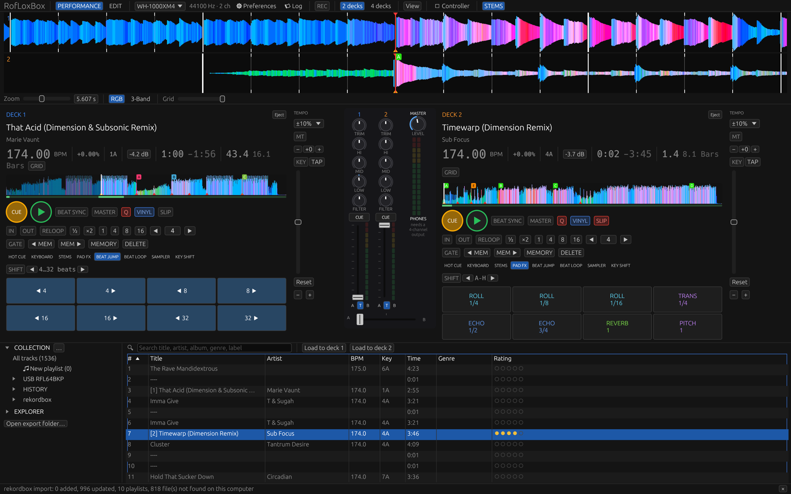
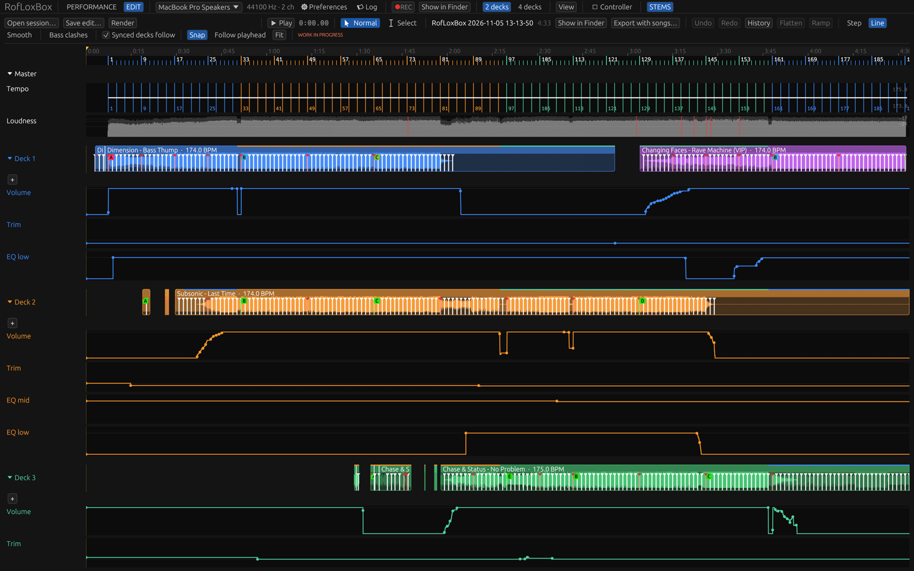

# RofLoxBox

(Working name in the code: deckhand.)

A DJ app for macOS, Windows and Linux, written in Rust: two or four decks,
a full mixer with effects, live stems, a library that works with rekordbox
and Pioneer DJ / AlphaTheta gear, and a recorder that keeps every move of a
set so you can fix it afterwards in a small DAW. No subscriptions,
accounts, telemetry or ads. See [PLAN.md](PLAN.md) for scope, ground rules
and roadmap.


*Performance view*


*EDIT view*

## Disclaimer: back up your rekordbox library first

RofLoxBox can read and **change rekordbox's own library** (`master.db`, its
playlist list and its analysis files). Before you use it with your rekordbox
library, and above all before you turn on **Preferences → Library → Write
changes back to rekordbox**, make a backup of the library in rekordbox:
**File → Library → Backup Library**, and keep it somewhere safe.

- Use it at your own risk. It comes with no warranty: a bug could damage or
  lose your library, cues, beat grids or playlists.
- Close rekordbox before RofLoxBox saves into its library; it refuses to save
  while rekordbox runs.
- RofLoxBox keeps a copy of the library from before each save, in
  `rekordbox-backups` next to its settings
  (`~/Library/Application Support/deckhand/` on macOS,
  `%APPDATA%\deckhand\` on Windows). That is a safety net, not a
  replacement for your own backup.
- RofLoxBox is not made, endorsed or supported by AlphaTheta or Pioneer DJ;
  rekordbox is their trademark. Don't ask them for help with a library
  RofLoxBox changed.

## Features

### Decks

- Two or four decks with scrolling and overview waveforms (rekordbox's RGB
  look, or CDJ-style 3-band), beat grids, hot cues, memory cues and loops.
  **Preferences → Waveform detail → High** draws the deck waveforms four
  times finer than rekordbox's analysis.
- CUE / PLAY, SYNC with a master deck, quantize, slip, vinyl mode, beat
  loops and loop resizing, beat jump, GATE (hot cues play only while held)
  and **Beat grid edit** for fixing a grid by hand.
- Tempo fader with selectable ranges, **MT** (Master Tempo: the key stays
  when the tempo changes), key shift, key sync and TAP BPM.
- Pads: hot cues, Pad FX, Beat Loop, Beat Jump, Sampler, Key Shift, Keyboard and
  Stems modes, as on rekordbox-compatible controllers.
- Drag a running waveform to scrub: the deck stops under the mouse and plays
  on from there when you let go.

### Mixer and effects

- EQ (or isolator), trim with automatic track gain, faders and crossfader
  with selectable curves, master and headphone cue, a master limiter.
- **Color FX** on every channel: Filter, Space, Dub Echo, Crush, Noise and
  Pitch. Played live, the channel knob drives the type selected on the
  mixer; the filter glides, so fast moves and switches don't click.
- **Beat FX**: 14 beat-synced effects (Delay, Echo, Reverb, Roll, Flanger,
  Phaser, Trans, Filter, …) on a channel, the master or the sampler, with
  TAP and Release FX. The depth knob is wet/dry: 0% leaves the sound alone,
  50% is half each, 100% is only the effect.
- An 8-slot sampler playing the first eight audio files in the `samples`
  folder next to the settings.

### Stems

- **Live stems**: loaded tracks are separated in the background, the part
  around the playhead first (instantly when done before). VOCAL, INST, BASS
  and DRUMS switch parts off; ISO turns the EQ knobs into vocal, instrument
  and drum levels. With every part on, the deck plays the original exactly.
  Load the same track on a second deck and it shares the separation already
  running.
- **Make** (right-click a track): an acapella, an instrumental, the track
  without drums or one stem alone, as a new 24-bit WAV that keeps the
  original's cues, loops, beat grid and key.
- Any separation model works: Preferences → Stems takes a folder with a
  `model.toml` naming its stems and the command that separates a track;
  Demucs and audio-separator come as presets.

### Library

- **Collection**: RofLoxBox's own library. Add folders or files (or drop
  them on the window), make playlists and folders, drag tracks onto
  playlists, edit tags, ratings and colours.
- **rekordbox**: import your rekordbox library (its `master.db` directly,
  or an XML export) with playlists, beat grids, cues and ratings. RofLoxBox
  can also write changes back into rekordbox's own library, if you turn it
  on (read the disclaimer above first).
- **USB / SD exports**: play straight from a rekordbox export, or export
  playlists to a stick for CDJs and XDJs. `export.pdb`, `exportExt.pdb`, the
  analysis files and the settings files are written byte-identical to
  rekordbox's.
- The track lists show each track's cover and a **Preview** column: the
  whole waveform with its hot cues and memory cues. Columns can be chosen,
  moved and sorted.
- BPM, beat grid and key are worked out on load for tracks that have none.

### Layout editing

The screen is yours to arrange, all from the **View** menu:

- **Waveforms** horizontal at the top, or vertical between the decks; show
  or hide the waveforms, the mixer, the library and the FX strip, and pick
  which parts of the mixer and FX strip appear.
- **Deck elements**: tick which controls each deck shows (separately for
  the 2-deck and 4-deck layouts).
- **Edit deck layout (drag elements)**: drag a control onto another (left or
  right half), onto **+** at the end of a row or the side column, onto
  **New row**, or onto **Hide**. In the same mode, drag the decks, the
  waveforms or the mixer by their bar onto an edge of another block to
  rearrange the whole screen (or pick one under **Screen arrangement**).
- **View presets**: save the current view under a name and switch between
  views in one click. **Export presets…** writes them to a file and
  **Import presets…** reads them back, to keep them safe or take them to
  another computer.
- **Preferences → Appearance**: dark, light, or following the system, and
  the text size in percent.

### Controllers and keyboard

- Pioneer DJ / AlphaTheta controllers (built around the DDJ-GRV6) work out
  of the box and report their fader and knob positions when they connect,
  so the software starts where the hardware is.
- Any MIDI controller can be mapped: open **Controller**, pick its port,
  press **Learn** next to a function and move the control. Mappings are
  saved in `mappings/` next to the settings.
- The computer keyboard mixes too, with the keys of rekordbox's
  Performance 1 preset (`Z`/`N` play, `A`/`H` cue, `Q`/`Y` sync, `1`–`4` /
  `6`–`9` hot cues, …). Preferences → Keyboard lists and moves them.

### Recording and EDIT mode (work in progress)

> **EDIT mode is a work in progress.** It is new and not yet tested much in
> real use: expect rough edges and changes, and keep your original
> recordings (edits are saved as new files and never change them).

**REC** records the master to a folder of its own in `Music/RofLoxBox
Recordings`: the 24-bit WAV, a `.session` file with everything that was
played (the tracks, every knob, fader, button and jog movement, sync, beat
grids) and the stems the decks used. Preferences → Audio → **Replay a
session…** plays a session through the mixer again, and it comes out
identical to the recording, sample for sample.

**EDIT** in the top bar turns the app into a little DAW for a recorded set.
Open a session:

- **Decks**: each deck shows what it played, its waveform bright where it
  reached the mix, with the beat grid. Drag a clip by its title to move it,
  drag inside it to slide its audio (to fix a beatmatch), shrink it by its
  edges, double-click to split it and right-click a piece to cut it out or
  bring it back. After a split, dragging moves the piece you grab.
- **Lanes**: a lane of automation for each knob and fader: volume, trim, EQ,
  tempo, crossfader, master, and an **intensity** lane for every Color FX
  type on every deck (Filter, Space, Dub Echo, Crush, Noise, Pitch). The
  types are separate, so you can add a Space on deck 2 for eight bars
  afterwards, alongside the filter you played, even if you never touched
  Space live. Press **+** under a deck (or the mixer, or Effects) to show
  more lanes. Double-click to add a point, drag to move it, right-click to
  delete it; points step, run in lines or ease in curves; select a stretch
  to flatten or ramp it, or right-click it to **reset it to the original**
  recording.
- **Effects**: a Color FX row shows where each deck's Color FX were on.
  The Beat FX play as blocks: right-click or double-click an empty spot in
  their row to open **Add Beat FX** (type, beat, what it is on, length,
  depth), drag a block or its edges to move or stretch it, and right-click
  it to change its type, beat (1/16 … 32), target, Release FX or depth, or
  remove it (or click it and press **Delete**). A block's name shows its
  settings, e.g. `ECHO 1/4 · MST`; each change of type, beat, target or
  Release FX is a block of its own. To change only part of an effect,
  select that part with **Select** and right-click it: another beat or type
  there makes it a new block. The line inside a
  block is its depth (wet/dry), with a handle at each edge: drag them up
  or down (start at 90% and end at 30%, say). Double-click to add points
  between (Step, Line or Smooth, as chosen in the toolbar), drag those up,
  down and along, right-click one to delete it. The depth goes along when
  the block is moved or stretched.
- **Tools**: **Normal** (key `1`) moves and edits; **Select** (key `2`)
  drags a stretch over a deck's clips, the Beat FX or a lane, and
  **Delete** cuts it out of the clips, takes the effects off through it, or
  takes a lane's points out and joins its sides in a straight line. Deleting
  a single point (right-click) also leaves a straight line, not a step. **Cmd + E** (Ctrl + E on Windows and Linux) splits the clips at both edges of the
  selection instead, so the selected part becomes a piece of its own.
  With **Normal**, drag the selected part to move just it: it is cut out
  and laid over whatever plays at its new place on that deck, leaving
  silence where it was. Dragging or clicking anything else lets go of the
  selection. The keys can be changed in Preferences → Keyboard →
  EDIT mode.
- **Play** (Space) listens to the edited set from the cursor (click the
  ruler to place it); edits are heard as you make them. **Bass clashes**
  marks where two decks' low end plays together.
  With **Select**, drag along the ruler to mark a range; **Render range**
  then plays only that part into the WAV (click the ruler to let go of it).
  Its sides can be dragged on the ruler with either tool. Undo, Redo and History keep
  the last 100 changes; **Save edit…** writes a new session and **Render**
  plays it into a new WAV.

## Building and running

```sh
cargo run --release -p deckhand-app   # the app
cargo test
```

The `deckhand` command-line tool reads and rewrites Pioneer formats:

```sh
cargo run -- pdb info      /Volumes/USB/PIONEER/rekordbox/export.pdb
cargo run -- pdb tracks    /Volumes/USB/PIONEER/rekordbox/export.pdb
cargo run -- pdb playlists /Volumes/USB/PIONEER/rekordbox/export.pdb
cargo run -- pdb tags      /Volumes/USB/PIONEER/rekordbox/exportExt.pdb
cargo run -- anlz          /Volumes/USB/PIONEER/USBANLZ/P016/0000875E/ANLZ0000.EXT
cargo run -- settings      /Volumes/USB/PIONEER/MYSETTING.DAT
cargo run -- usb rewrite   /Volumes/USB /Volumes/OTHER_USB   # rewrite an export with deckhand's writers
```

Settings, mappings, caches and backups live in
`~/Library/Application Support/deckhand/` on macOS and `%APPDATA%\deckhand\`
on Windows.

### Installers

Each script leaves its results in `target/dist/`:

- `scripts/build-macos.sh [--universal]` (on a Mac): `RofLoxBox.app`, a
  `.dmg` to drag it into Applications, and a `.zip`. `--universal` also
  runs on Intel Macs (`rustup target add x86_64-apple-darwin`).
- `scripts/build-windows.sh` (on macOS or Linux): a self-contained 64-bit
  Windows 10/11 `RofLoxBox.exe` in a `.zip` and, with NSIS
  (`brew install makensis`), a `-setup.exe` installer. Needs
  `cargo install cargo-xwin`, `rustup target add x86_64-pc-windows-msvc` and
  `brew install innoextract` (it unpacks a ready-built OpenSSL for Windows,
  downloaded once and checked against its published hash).
- `scripts/build-linux.sh` (on Linux, with `libasound2-dev`): a `.tar.gz`
  and, with `appimagetool`, an AppImage.

Every commit is a new version, `0.<number of commits>.0`
(`scripts/version.sh`; shown in the window title). A build with uncommitted
changes is marked as the version they will become: `0.<commits + 1>.0-dev`. Each push to `main` runs
`.github/workflows/release.yml`, which builds all three on GitHub's machines
and publishes them as the release `v0.<n>.0`, with their SHA-256 sums.
`scripts/publish-release.sh [--draft]` uploads the builds of this version
from `target/dist/` to that release yourself (needs the GitHub CLI:
`brew install gh && gh auth login`, and the commit pushed).

Signing needs your own certificates; without them the builds are unsigned
(macOS ad hoc: open it once with right-click → Open; Windows SmartScreen
warns once). The scripts read `MACOS_SIGN_IDENTITY` and
`MACOS_NOTARY_PROFILE` (Apple Developer ID and notarization) and
`WINDOWS_SIGN_PFX` / `WINDOWS_SIGN_PASSWORD`; the workflow reads the
repository secrets listed at its top. Linux packages are not signed.

The icon is `packaging/icon.svg`; `packaging/make-icons.sh` renders the
`.icns`, `.ico` and `.png` files in `packaging/icons/` from it.

## Crates

- `crates/formats` (`deckhand-formats`): Pioneer on-disk formats
- `crates/cli` (`deckhand`): command-line tool
- `crates/library` (`deckhand-library`): deckhand's own collection
  (`collection.json`), folder scanning and tag reading (`lofty`)
- `crates/audio` (`deckhand-audio`): decoding and the real-time mixer
- `crates/control` (`deckhand-control`): MIDI input, mappings, learn mode
- `crates/app` (`deckhand-app`): the desktop application

## Support me

[](https://buymeacoffee.com/roflox)
